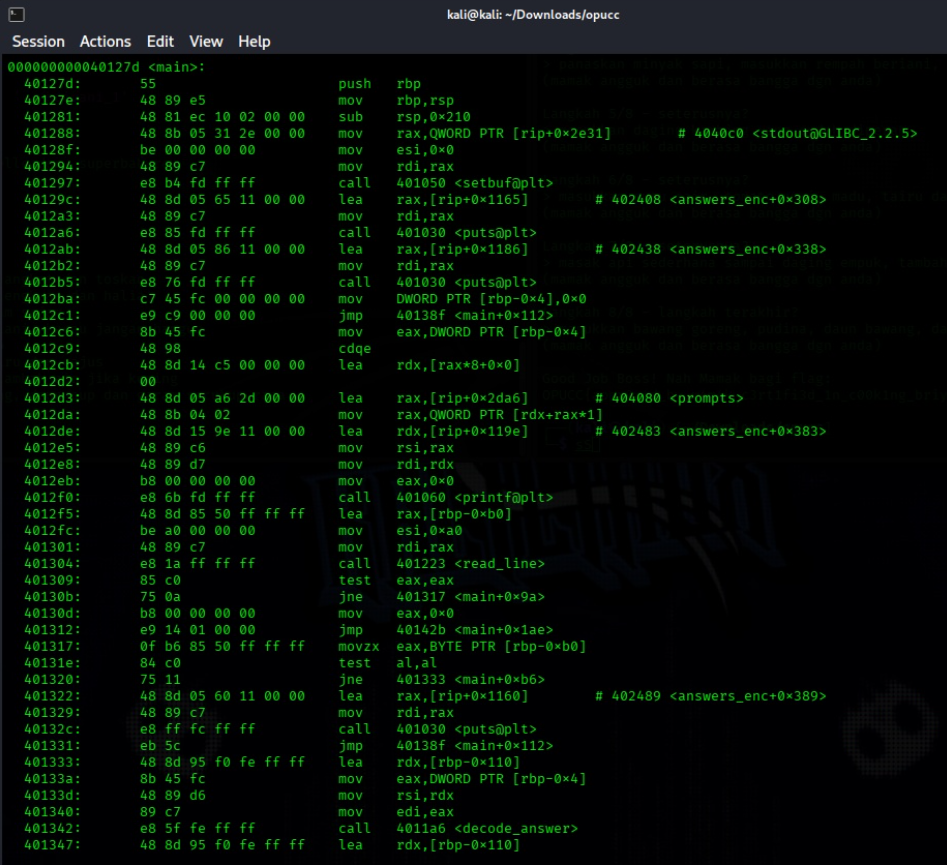
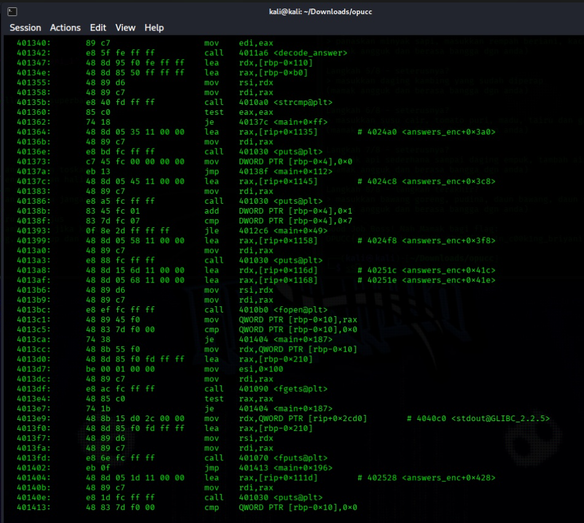
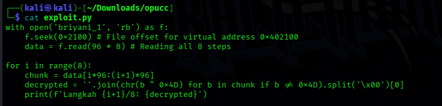
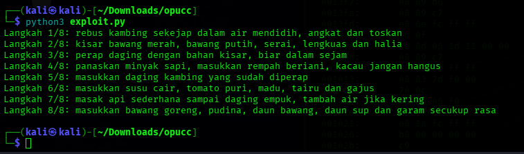
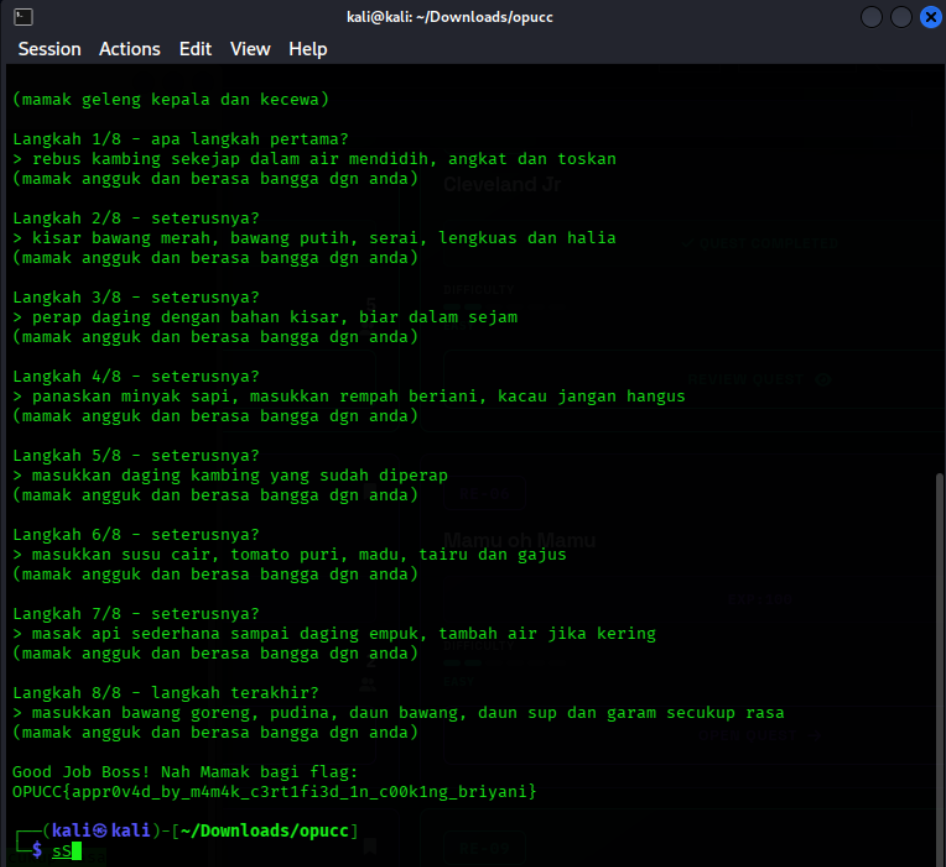

# Writeup: Mamu Oh Mamu (Reverse Engineering)

## Challenge Overview

* **Name**: Mamu Oh Mamu

* **Category**: Reverse Engineering

* **Objective**: Bypass an 8-step validation check inside a Linux ELF binary (`briyani`) by supplying the correct traditional recipe steps for Nasi Briyani.

## Phase 1: Analyzing the Validation Mechanism

To understand how the program verified our inputs, we disassembled the binary to inspect `main` and the answer-checking logic.

* **Disassembly Insights**:

  * The `main` function runs a loop that prompts the user **8 times** for recipe steps.

  * Running a standard `strings` command didn't show plain text answers because the developer obfuscated them.

  * Disassembling the `<decode_answer>` function revealed that the binary reads from an encoded data section (`answers_enc` starting at virtual address `0x402100`) and decrypts the answers at runtime by **XORing each byte with `0x4D`** (the ASCII value for `'M'`).
  
  
  

## Phase 2: Designing the Decryption Script (How We Built It)

Since the program decrypts answers using a mathematical operation (byte-level XOR), we realized we didn't need to manually reverse-engineer or guess the Malay cooking steps. We could write a Python script to automate the exact same decryption routine the binary uses.

### Step-by-Step Script Logic:

1. **Opening the Binary File**: We needed to read the binary file as raw bytes (`'rb'` mode) to extract the raw machine code and data sections.

2. **Finding the Correct Offset**: Virtual memory address `0x402100` maps to a specific file offset in the ELF binary, which is located at `0x2100`. We used `f.seek(0x2100)` to jump straight to where the encrypted answers begin.

3. **Calculating Chunk Size**: By inspecting the loop offsets in the assembly, we determined that each answer slot spans 96 bytes. To cover all 8 steps, we read `96 * 8` total bytes.

4. **Applying the XOR Reversal**: XOR is a symmetric operation ($A \oplus Key = Cipher$, and $Cipher \oplus Key = A$). To reverse it, our script iterates through every byte (`b`) in each chunk and performs `b ^ 0x4D`.

5. **Cleaning the Output**: We filtered out null bytes (`\x00`) and padding to cleanly split the resulting ASCII strings.

### Final Script (`exploit.py`):





## Phase 3: Troubleshooting Execution Errors (Trial and Error)

During execution, we encountered a couple of common terminal hiccups:

* **FileNotFoundError**: When we first ran `python3 exploit.py`, Python threw an error because the script was executed from a nested subdirectory (`~/Downloads/opucc`), but the binary was stored in the parent `Downloads` directory.

* **Fixing Paths**: We copied the binary into our active working directory and updated the filename reference to match `briyani_1`. Once aligned, the script executed instantly without errors.

## Phase 4: Flag Retrieval

Running the finished script successfully printed out all 8 exact string requirements expected by the binary:



Feeding these steps sequentially into the live netcat server (`nc 10.5.14.225 30014`) successfully validated the binary interaction and outputted the final flag:

```
OPUCC{appr0v4d_by_m4m4k_c3rt1fi3d_1n_c00k1ng_briyani}

```