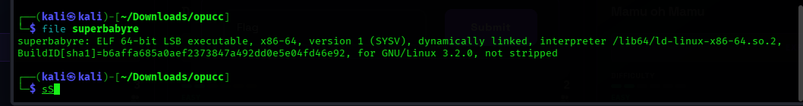
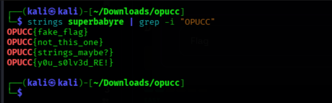

# CTF Write-Up: SuperbabyRE

| Attribute | Details | 
| ----- | ----- | 
| **Category** | Reverse Engineering | 
| **Difficulty** | Easy / Beginner | 
| **Flag Format** | `OPUCC{flag}` | 


## 1. Challenge Overview

The **SuperbabyRE** challenge is a beginner reverse engineering task designed to demonstrate fundamental binary analysis techniques in a Linux environment. The objective is to analyze the provided executable and extract the hidden flag.

## 2. Reconnaissance & File Inspection

First, navigate to the directory where the challenge binary is downloaded and check its file type using the `file` command:

```bash
cd ~/Downloads
file superbabyre
```

### Output:

```text
superbabyre: ELF 64-bit LSB executable, x86-64, version 1 (SYSV), dynamically linked, interpreter /lib64/ld-linux-x86-64.so.2, for GNU/Linux 3.2.0, not stripped
```



### Key Observations:

* **ELF 64-bit LSB executable**: Standard 64-bit Linux binary.
* **Not stripped**: Symbol table and function names are preserved, making analysis simpler.

---

## 3. Dynamic Analysis & Execution

Grant executable permissions to the binary and execute it to observe its default behavior:

```bash
chmod +x superbabyre
./superbabyre
```

To inspect dynamic library calls made by the executable during runtime, run the binary under `ltrace`:

```bash
ltrace ./superbabyre
```

This command tracks calls to standard C functions such as `printf`, `puts`, or `strcmp`.


---

## 4. Static Analysis & String Extraction

Since reverse engineering challenges frequently store flag patterns or hints in human-readable strings, use the `strings` command filtered with `grep` to look for the target flag format:

```bash
strings superbabyre | grep -i "OPUCC"
```


### Output:

```text
OPUCC{fake_flag}
OPUCC{not_this_one}
OPUCC{strings_maybe?}
OPUCC{y0u_s0lv3d_RE!}
```


---

## 5. Analysis & Verification

The string extraction returned four flag-formatted strings:

1. `OPUCC{fake_flag}` — Decoy string
2. `OPUCC{not_this_one}` — Decoy string
3. `OPUCC{strings_maybe?}` — Decoy string
4. `OPUCC{y0u_s0lv3d_RE!}` — **Valid Flag**

Challenge authors include decoy flags to prevent simple automated scripts from capturing the flag without manual inspection. Comparing the returned strings confirms that `OPUCC{y0u_s0lv3d_RE!}` is the intended solution.

To verify available function symbols in the unstripped binary, run:

```bash
nm superbabyre | grep -i "t "
```


---

## 6. Flag

```text
OPUCC{y0u_s0lv3d_RE!}
```