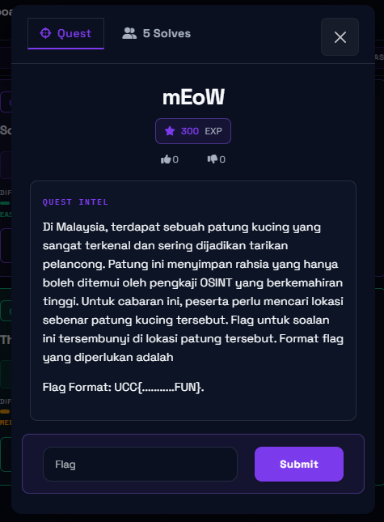
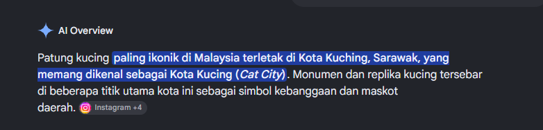
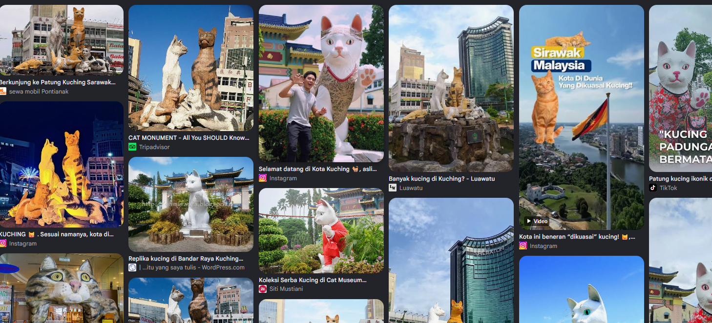
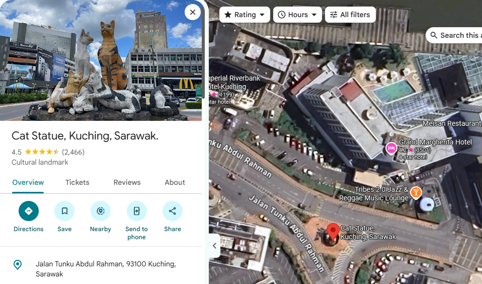
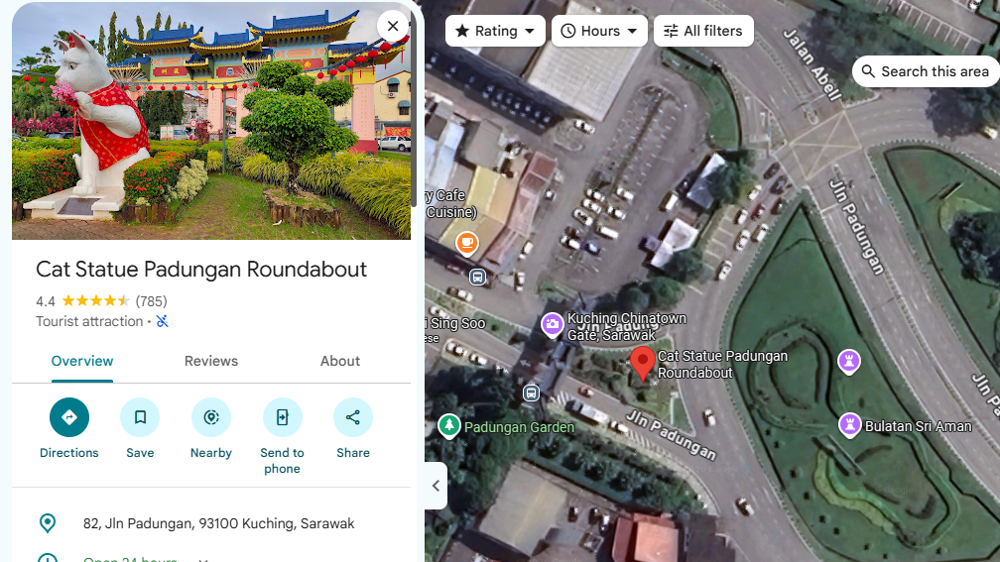
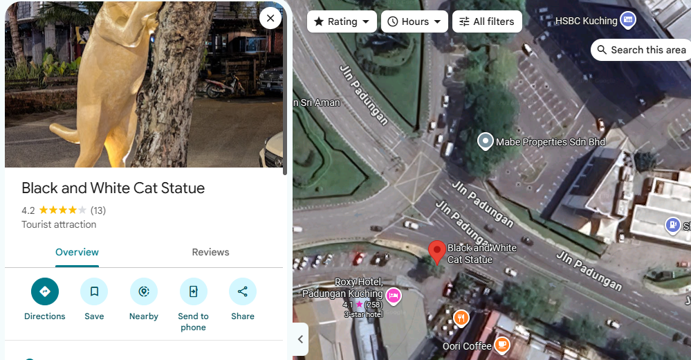
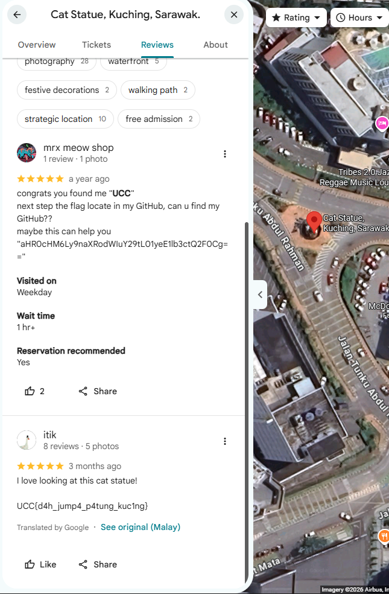

# CTF Writeup: MeOw

* **Category**: Osint
* **Difficulty**: Medium
* **Objective**: makan nasi kandar( jk find the flag)
---

## 1. Reasearch 

Do some research about famous cat statue in malaysia. Probably in kuching bruh.

### Key Findings:
* So i suspect 3 cat statue in kuching 

---

## 2. Find and get the flag rahhhhhhhhhhhhhhhhhhhh

I noticed that in instruction challenge did not mention any coordinate, time or any format for the flag. So pretty sure the flag is in the comment or review section.

---

im going through all the review section for each of the cats statue by using filter to search "ucc" . i was really getting baited by the mrx meow shop. But anyway we found the flag.

